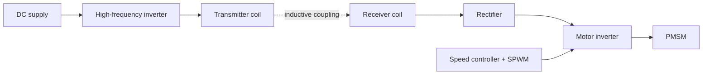

Undergraduate research at NTU under the URECA programme, August 2024 to May 2025, supervised by Prof. Christopher H. T. Lee. I was named a **President's Research Scholar** for this work.

## The problem

Robot joints and rotating stages carry power through cables or slip rings. These wear out, limit how far a joint can rotate, and add failure points. The question was whether a permanent-magnet synchronous motor (PMSM) could be powered across an air gap instead.

## The system

I built a simulation model of the full power path:

- **Wireless power transfer:** inductive coupling with a series–series compensated coil pair.
- **Motor control:** sinusoidal pulse-width modulation (SPWM) on the motor inverter, regulating speed and torque.
- **Testing:** the model was run under no-load and loaded conditions.

## Reflection

This was my first research project. I didn't contribute much at the start, but it gave me a taste of how research works and sparked my interest in pursuing advanced studies.
