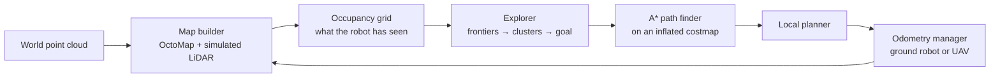

A pre-research exercise at the SJTU RAP Lab: build a complete autonomous exploration system in ROS (C++) without relying on the navigation stack. The robot is dropped into an unknown map and must keep choosing where to go next until nothing is left to explore. The method follows Yamauchi's frontier-based exploration ([CIRA 1997](https://doi.org/10.1109/CIRA.1997.613851)).

**Demo video:** [youtube.com/watch?v=MhtYzAHmc9I](https://www.youtube.com/watch?v=MhtYzAHmc9I)
**Code:** [github.com/dunyanong/exploration-preresearch](https://github.com/dunyanong/exploration-preresearch)

## System

- **Map builder.** Loads the world point cloud into an OctoMap and ray-casts a simulated LiDAR from the robot's pose. It publishes only the part of the map the robot has actually seen.
- **Explorer.** Marks free cells next to unknown cells as frontier cells, clusters neighbouring ones, discards clusters below a minimum size, and picks the nearest accessible cluster as the next goal.
  - Goals the robot fails to reach are blacklisted, so it doesn't keep retrying them.
  - If no frontier is reachable, it falls back to retreating or a random walk instead of stopping.
- **Path finder.** Runs A* on a costmap inflated around obstacles.
- **Local planner.** Follows the A* path.
- **Odometry manager.** Supports both a ground vehicle and a UAV model.

Exploration ends when no frontier clusters remain.

