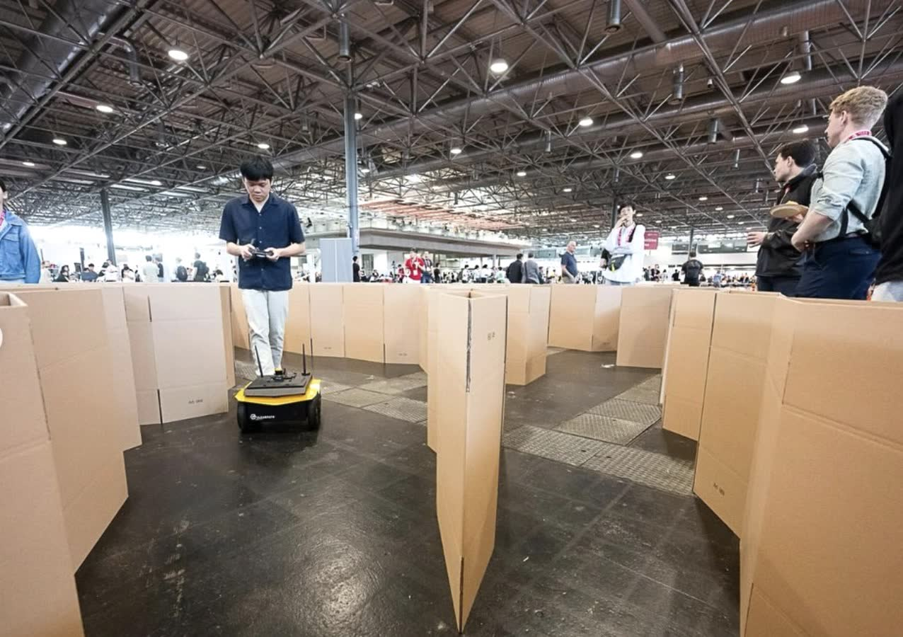
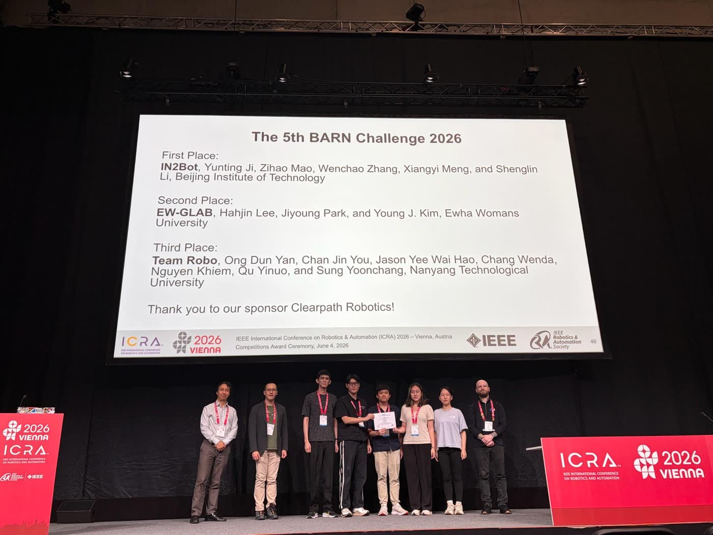
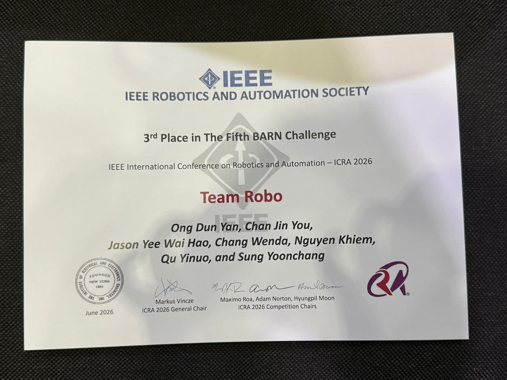
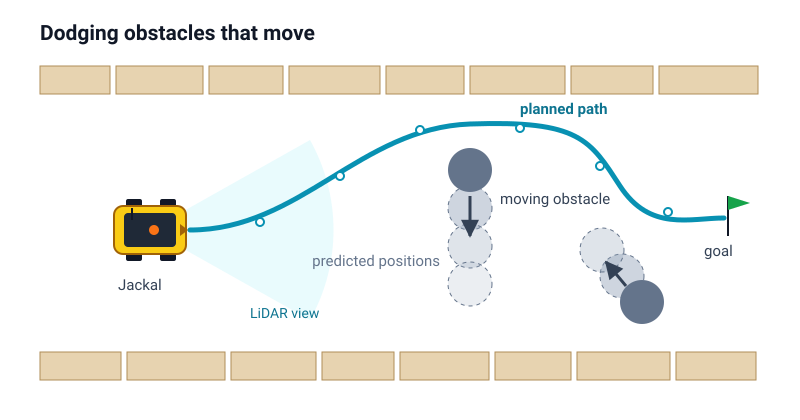
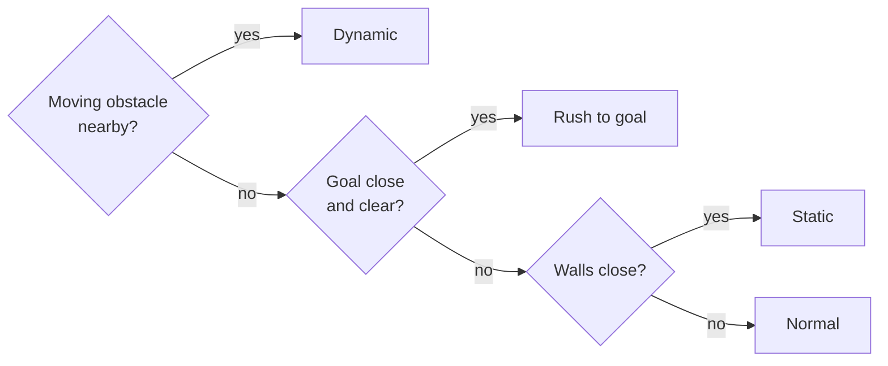
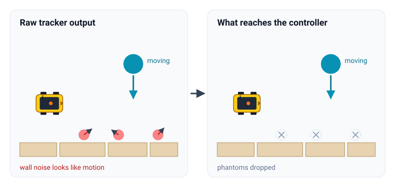
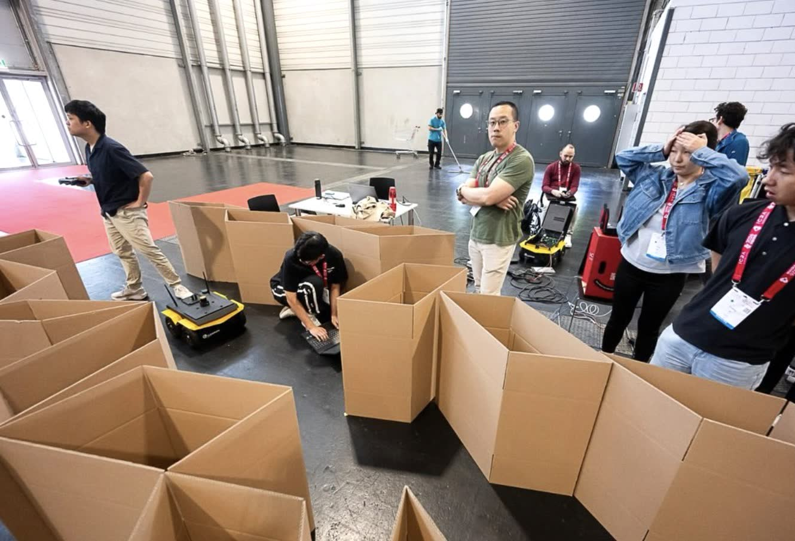

The **BARN (Benchmark Autonomous Robot Navigation) Challenge** asks teams to drive a Clearpath Jackal through dense, narrow obstacle courses as fast as possible without touching anything. The robot has a single 270° 2D LiDAR and a 2 m/s top speed. I led Team Robo from NTU (8 members) in the 2026 edition, held at ICRA 2026 in Vienna.

| Stage | Result |
|---|---|
| Simulation (17 teams) | 6th, score 0.4515, invited to the physical finals |
| Physical finals, Vienna, 2–4 June 2026 | **3rd place**, 3 of 9 trials successful |
| Dynamic-environment benchmark | **1st all-time** |

_Physical finals at the Vienna Congress & Convention Center. The course is built from cardboard boxes and changes between rounds._

### Two runs from the physical final

  <video class="portrait-video" src="/assets/img/projects/barn2026/physical-final-trial-1.mp4" poster="/assets/img/projects/barn2026/physical-final-trial-1-poster.jpg" controls muted playsinline preload="none" aria-label="Physical final, trial 1"></video>
  <video class="portrait-video" src="/assets/img/projects/barn2026/physical-final-trial-2.mp4" poster="/assets/img/projects/barn2026/physical-final-trial-2-poster.jpg" controls muted playsinline preload="none" aria-label="Physical final, trial 2"></video>

_Left: trial 1. Right: trial 2. The Jackal runs fully autonomously on its 2D LiDAR through the cardboard course._

_Award ceremony at ICRA 2026, Vienna: Team Robo from NTU in third place._

{: width="700" }
_The IEEE Robotics and Automation Society certificate for 3rd place._

## Approach: one NMPC, several modes

Most BARN stacks are tuned for static clutter. We built a **nonlinear model predictive controller (NMPC)** that can handle static walls and moving obstacles in the same optimisation, solved in real time with [acados](https://github.com/acados/acados). Many times a second it plans a short stretch of motion ahead, applies the first step, and plans again.

_The idea in one picture: moving obstacles are tracked, their future positions predicted, and the planned path bends around where they will be, not where they are._

### The robot model

The Jackal is a differential-drive robot. We model its two wheel speeds directly, so the controller respects how quickly the real wheels can speed up and slow down:

$$
\begin{gathered}
v = \frac{v_r + v_l}{2}, \qquad \omega = \frac{v_r - v_l}{L} \\[6pt]
\dot x = v\cos\theta,\quad \dot y = v\sin\theta,\quad \dot\theta = \omega
\end{gathered}
$$

### The optimisation, in words

$$
\begin{gathered}
\min_{\text{controls}}\;
\underbrace{\text{tracking error}}_{\text{stay on the path}}
+ \underbrace{\text{control effort}}_{\text{move smoothly}} \\[8pt]
\text{subject to}\quad
\underbrace{\text{robot limits}}_{\text{speed, turning}},\;\;
\underbrace{\text{clearance}}_{\text{now and predicted}}
\end{gathered}
$$

The clearance constraints are *soft*: in a gap tighter than the safety margin, the solver may give up a little clearance at a high cost instead of failing outright. In a course as tight as BARN, that difference matters.

### Modes: same solver, different priorities

The repository is called *mode-switching* MPC because the controller changes what it prioritises depending on the situation. The optimisation stays the same; each mode adjusts what it is asked to do.

- **Normal:** open space, go fast.
- **Static:** tight walls, move carefully.
- **Dynamic:** something is moving nearby, plan around where it is heading.
- **Rush to goal:** the finish is close and clear.
- When the path doubles back, the robot can also turn on the spot or reverse out instead of attempting a wide turn.

### Tracking moving obstacles

The moving obstacles come from our [obstacle tracker](https://github.com/Team-Robo/perc-obstacle_detector), built on Mateusz Przybyła's [`obstacle_detector`](https://github.com/tysik/obstacle_detector). It turns the laser scan into shapes and follows them over time to estimate how fast each one is moving.

A raw tracker reports *everything*, including walls that only seem to move because of sensor noise. We added a filter so that only genuinely moving obstacles reach the controller, which stops the robot from swerving around phantoms.

_Left: the raw tracker sees "motion" in wall noise. Right: after our filter, only the real moving obstacle is passed on._

### Simulation vs. the physical finals

The work lives in two branches of [the repository](https://github.com/Team-Robo/core-mode_switching_mpc_2026):

- **`v3.0`, simulation:** the full stack including moving-obstacle tracking, used for the dynamic benchmark.
- **`main`, physical finals:** the version that ran in Vienna. The 2026 courses were static, so tracking was switched off. It is packaged as a standard `move_base` plugin and hardened for real sensor noise.

_Setting up between trials. Each team gets a fixed time slot per course._

## Context from the finals

- **Simulation and physical rankings differed.** Only four of the seven invited teams competed in Vienna, and the order changed: we placed 6th in simulation and 3rd on the real robot.
- **The 2026 courses were static only.** Unlike earlier editions, there was no dynamic-obstacle component. Our dynamic handling went unused in the finals, but it is what ranks us first all-time on the dynamic-environment benchmark.
- **Every team in the finals used classical methods.** For the second year in a row, no finalist used machine learning in their navigation stack.

Our approach is described in the organisers' article on the competition: *Autonomous Ground Navigation in Highly Constrained Spaces: Lessons Learned from the Fifth BARN Challenge at ICRA 2026*, submitted to IEEE Robotics and Automation Magazine.

## My role

- Led the 8-member team through the simulation qualifier and the physical finals.
- Wrote most of the [mode-switching MPC planner](https://github.com/Team-Robo/core-mode_switching_mpc_2026) (C++, acados, ROS `move_base` plugin).
- Co-developed the laser-based [dynamic obstacle tracker](https://github.com/Team-Robo/perc-obstacle_detector), including the filter that keeps only genuinely moving obstacles.
- Also built and tested alternative planners we compared against: a [D* Lite global planner](https://github.com/Team-Robo/nav-D_Lite), a visibility-graph global planner (the same graph idea behind [VADER, my multi-robot navigation research](/posts/vader/)), and DDP-based local planning.
