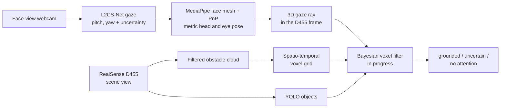

A side project, still in progress. The question: **can a robot tell which object you're looking at, using only two cheap cameras and no eye-tracking glasses?** If it can, "pass me that" becomes a command a robot can act on.

Gaze estimates from a webcam are noisy, often by several degrees. At a metre away, that's the width of a mug. ST-AVL (*Spatio-Temporal Attention Voxel Layer*) treats gaze as evidence that builds up over time in a 3D voxel grid, instead of trusting any single frame. Its output is one of three states: attention **grounded** on an object, **uncertain**, or **no attention**.

## Pipeline

**Gaze.** [L2CS-Net](https://github.com/Ahmednull/L2CS-Net) (ResNet-50, trained on Gaze360) estimates gaze pitch and yaw from the webcam, with an angular uncertainty. MediaPipe Face Mesh and a PnP solve give a metric head and eye position. Together they produce a 3D gaze ray.

**One world frame.** Everything is expressed in the D455's optical frame: objects, point clouds, voxels and the gaze ray. A ChArUco board calibrates the webcam into that frame once, and is re-checked each session.

**Scene.** The D455 depth stream is filtered into an obstacle cloud. That cloud feeds a standalone copy of the Spatio-Temporal Voxel Layer (STVL), which I separated from its Nav2 costmap plugin so that it runs as pure perception. YOLO labels the objects.

**Grounding (in progress).** A Bayesian filter over the voxel grid accumulates evidence along the gaze ray over time, then decides which object, if any, holds the person's attention.

## Baselines

To have something to beat, I reimplemented two methods from the GazeEMD paper (Shi et al., 2021) as ROS 2 nodes:

- **Fixation-based (I-DT):** detects fixations with a 3° dispersion threshold, then classifies intention by dwell time (90, 1000 or 2000 ms) inside an object's bounding box.
- **HitScan:** a per-frame test of whether the gaze falls in the box, with run-length filtering and hysteresis thresholds.

## Status

The sensing, calibration and fusion front-end works end to end in ROS 2 Humble. The voxel filter itself, and a comparison against the two baselines, are next.
