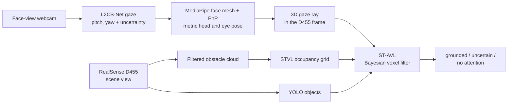
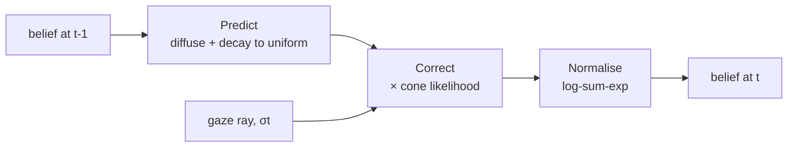
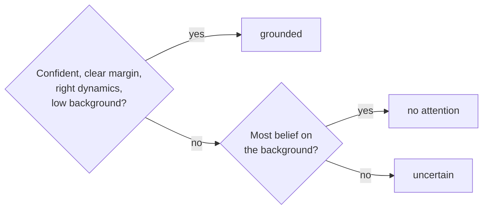

A toy project I'm working on with [Dr. Shenghai Yuan](https://scholar.google.com/citations?user=XcV_sesAAAAJ&hl=en). The question: **can a robot tell which object you're looking at, using only two cheap cameras and no eye-tracking glasses?** If it can, "pass me that" becomes a command a robot can act on.

Systems such as FAM-HRI (Lai, Yuan et al.) get gaze from wearable glasses. A webcam is cheaper and needs nothing on the user, but its gaze estimate is much coarser. ST-AVL (*Spatio-Temporal Attention Voxel Layer*) accepts that coarseness. It treats each gaze frame as weak evidence, builds that evidence up over time in a 3D grid, and only commits to an object when the evidence is clear. Its output is one of three states:

- **grounded:** one object clearly holds the person's attention;
- **uncertain:** attention is split between objects, or the evidence is too weak;
- **no attention:** the person is looking somewhere that isn't an object.

The second and third states are the point. A robot that says "I'm not sure" is safer than one that confidently picks the wrong cup.

> This post walks through the background, the maths and the system. The sensing front end runs in ROS 2; the filter and the user study are still in progress, so there are no results here yet.
{: .prompt-info }

## Why one gaze frame isn't enough

A webcam gaze estimator is typically off by 5–10°. On a table, an angular error $$\theta$$ at distance $$d$$ becomes a lateral error of about $$d \tan\theta$$:

$$
\begin{gathered}
0.5\,\text{m} \times \tan 5^\circ \approx 4.4\,\text{cm},
\\[6pt]
0.5\,\text{m} \times \tan 10^\circ \approx 8.8\,\text{cm}.
\end{gathered}
$$

Tabletop objects are often only 10–15 cm apart, so a single frame regularly lands between two of them. Two design choices follow:

1. **Integrate over time.** Weak evidence from many frames adds up to a sharp belief.
2. **Use the estimator's own uncertainty.** The width of the "gaze cone" should come from each frame's confidence, not a fixed guess.

And when the evidence still can't separate two objects, the honest answer is *uncertain*.

I also frame this as **attention grounding**, not intent recognition. The system can't read minds. It can only ground an observable signal (where the head and eyes point) onto objects, and decline to answer when that signal is ambiguous.

## Background

ST-AVL borrows from robot navigation, probabilistic filtering and appearance-based gaze estimation. Here is the minimum of each that the rest of the post needs.

### Costmaps

A navigating robot keeps a **costmap**: a grid over the world where each cell stores how bad it is to be there. Sensors mark cells as occupied, and an *inflation* layer adds a cost gradient around obstacles so the planner keeps its distance. In [Nav2](https://docs.nav2.org/), the ROS 2 navigation stack, the costmap is built from stacked plugin layers (static map, obstacles, inflation and so on), each written by a different source.

_A Nav2 costmap fed by a depth camera: occupied cells (cyan), the inflation gradient around them, and the planned path (purple). Insets: the colour and depth images. Figure: [Nav2 docs](https://docs.nav2.org/rolling/tutorials/general_tutorials/depth_ai_integration/depth_ai_integration/), Apache-2.0._

### Voxel layers and STVL

A 2D grid can't represent a table edge at 70 cm or an overhang. A **voxel layer** extends the costmap to 3D: space is cut into small cubes (voxels), and depth or lidar data marks the ones that are occupied.

The **Spatio-Temporal Voxel Layer** (STVL, Macenski et al., 2020) adds two ideas that ST-AVL reuses:

- **Temporal decay.** Voxels fade if they aren't re-observed, so people who walk away disappear from the map instead of leaving ghost obstacles.
- **Frustum models.** Each sensor's field of view is modelled as a 3D frustum, which makes deciding which voxels to update fast.

<video class="post-video" src="/assets/img/projects/st-avl/stvl-demo.mp4" poster="/assets/img/projects/st-avl/stvl-demo-poster.jpg" autoplay muted loop playsinline preload="metadata"></video>
_STVL in action: voxels (purple) are marked by a depth sensor and decay once they leave its view. Clip: [STVL repository](https://github.com/SteveMacenski/spatio_temporal_voxel_layer), LGPL-2.1._

**The key move in ST-AVL** is to keep the grid, the frustum-shaped observations and the decay, but change *what each voxel stores*:

| | STVL | ST-AVL |
|---|---|---|
| Each voxel stores | Occupancy: is something here? | Attention: is the person looking here? |
| Observations come from | Depth sensors | A gaze ray from the webcam |
| Old information | Decays in time | Diffuses and decays toward uniform |
| Used for | Obstacle avoidance | Choosing which object is attended |

ST-AVL also runs an ordinary STVL occupancy grid alongside, to know where the physical surfaces are. That becomes important in the observation model below.

### The Bayes filter

A **Bayes filter** keeps a *belief*, a probability distribution over the hidden state, and updates it in two steps every time a measurement arrives (Thrun, Burgard and Fox, *Probabilistic Robotics*):

1. **Predict.** Push the old belief through a motion model. Uncertainty grows.
2. **Correct.** Multiply in the likelihood of the new measurement, then renormalise so it sums to 1. Uncertainty shrinks.

$$
\begin{gathered}
\overline{\mathrm{bel}}_t(x) = \sum_{x'} p(x \mid x')\,\mathrm{bel}_{t-1}(x'),
\\[6pt]
\mathrm{bel}_t(x) = \eta\; p(z_t \mid x)\;\overline{\mathrm{bel}}_t(x).
\end{gathered}
$$

In ST-AVL the hidden state is "which voxel is being looked at", the measurement is a gaze ray, and $$\eta$$ is the normalising constant.

### Appearance-based gaze estimation

[L2CS-Net](https://github.com/Ahmednull/L2CS-Net) (Abdelrahman et al., 2023) estimates gaze from a single face crop. It predicts pitch and yaw separately. For each angle, it classifies into angle bins with a softmax and then regresses a continuous value from that distribution. That design is useful here: the **spread of the softmax** gives a per-frame uncertainty for free.

_L2CS-Net estimating gaze direction (red arrows) from face crops. Figure: [L2CS-Net repository](https://github.com/Ahmednull/L2CS-Net), MIT._

## The system

**Gaze.** L2CS-Net (ResNet-50, trained on Gaze360) gives pitch, yaw and an angular uncertainty $$\sigma_t$$: the standard deviation of its softmax over angle bins. Softmax outputs are usually overconfident, so the raw spread is scaled by one gain, calibrated against measured gaze-to-object residuals. MediaPipe Face Mesh plus a PnP solve, with a face model scaled to a ~63 mm inter-ocular distance, gives the metric eye position.

**One world frame.** Everything is expressed in the D455's optical frame: objects, point clouds, voxels and the gaze ray. Linking the webcam to it takes two ChArUco calibrations:

- **Webcam intrinsics, once.** Wave a ChArUco board in front of the webcam in 15–20 poses, then run `calibrateCameraCharuco`.
- **Webcam-to-D455 extrinsic, per session.** Lay the board flat on the table where both cameras see it. Each camera estimates the board's pose, and the two are chained:

$$
{}^{D455}T_{\mathrm{cam}} = {}^{D455}T_{\mathrm{board}}\,\big({}^{\mathrm{cam}}T_{\mathrm{board}}\big)^{-1}.
$$

The board is then removed, and each frame's eye position and gaze direction are mapped into the world:

$$
\begin{gathered}
\mathbf{p}_u^W(t) = {}^{D455}R_{\mathrm{cam}}\,\mathbf{p}_u^{\mathrm{cam}}(t) + {}^{D455}\mathbf{t}_{\mathrm{cam}},
\\[6pt]
\mathbf{g}_t^W = {}^{D455}R_{\mathrm{cam}}\,\mathbf{g}_t^{\mathrm{cam}}.
\end{gathered}
$$

Calibration can't fix a systematic bias in the gaze network. The filter absorbs noise through $$\sigma_t$$, but a constant offset passes straight through.

**Scene.** The D455 depth stream is filtered into an obstacle cloud, which feeds a standalone copy of STVL that I separated from its Nav2 costmap plugin so it runs as pure perception. YOLO detects the objects, and each detection's points are projected into the voxel grid as that object's *mask*.

## The filter

### Belief over voxels

The interaction volume above the table is cut into $$M$$ voxels $$v_1, \dots, v_M$$ with centres $$\mathbf{p}_k$$. The filter keeps a normalised belief over them:

$$
\begin{gathered}
\mathrm{bel}_t(v_k) = P\big(v_k \text{ is attended} \mid z_{1:t}\big),
\\[6pt]
\sum_{k=1}^{M} \mathrm{bel}_t(v_k) = 1.
\end{gathered}
$$

### Observation model: a cone with a depth band

Each frame gives an observation $$z_t = \{\mathbf{p}_u(t), \mathbf{g}_t, \sigma_t\}$$: eye position, unit gaze direction and angular uncertainty. For each voxel, the filter measures how far it lies off the gaze ray:

$$
\begin{gathered}
\mathbf{d}_k(t) = \frac{\mathbf{p}_k - \mathbf{p}_u(t)}{\lVert \mathbf{p}_k - \mathbf{p}_u(t) \rVert},
\\[6pt]
\theta_k(t) = \cos^{-1}\!\big(\mathbf{g}_t^{\top}\mathbf{d}_k(t)\big).
\end{gathered}
$$

The likelihood is a Gaussian cone around the ray, multiplied by a range term, plus a small floor:

$$
\begin{gathered}
P(z_t \mid v_k) = (1-\epsilon)\,\exp\!\left(-\frac{\theta_k(t)^2}{2\sigma_t^2}\right)\rho_k(t) + \epsilon,
\\[6pt]
\rho_k(t) = \exp\!\left(-\frac{\big(\lVert \mathbf{p}_k - \mathbf{p}_u(t)\rVert - r_0(t)\big)^2}{2\sigma_r^2}\right).
\end{gathered}
$$

_The observation model. The cone (blue) has width σₜ from the gaze network. The range band (orange) sits at r₀, where the ray first meets a surface, so the likelihood concentrates on the object being looked at._

Each piece has a job:

- **The cone width $$\sigma_t$$** comes from the network every frame. Confident frames make a narrow cone, and blurry ones make a wide one.
- **The range term $$\rho_k$$** matters more than it looks. Without it, a cone through 3D space puts most of its mass on empty air along the ray, and "no attention" would always win. So $$r_0(t)$$ is set each frame to where the ray first meets something solid: the nearest occupied voxel in the STVL grid, within a small radius of the ray. If the ray hits nothing, it falls back to the grid's mid-depth.
- **The floor $$\epsilon$$** (0.01) models the chance that a frame is simply wrong. Without it, one bad frame could push the true target's belief almost to zero, and it would take many frames to recover.

### Predict: attention drifts, and memory fades

People's attention persists for a moment and drifts locally. The prediction step diffuses the belief with a Gaussian kernel and blends it toward uniform:

$$
\begin{gathered}
\widetilde{\mathrm{bel}}_t(v_k) = \alpha \sum_{l=1}^{M} K(k,l)\,\mathrm{bel}_{t-1}(v_l) + (1-\alpha)\,\frac{1}{M},
\\[6pt]
K(k,l) = \eta_m \exp\!\left(-\frac{\lVert \mathbf{p}_k - \mathbf{p}_l \rVert^2}{2\sigma_m^2}\right).
\end{gathered}
$$

The persistence factor $$\alpha$$ is a memory knob. A high $$\alpha$$ means long memory, slow to forget. A low $$\alpha$$ means fast forgetting, quick to react. The uniform term pulls the belief back toward "I don't know" whenever evidence stops arriving, which is the attention version of STVL's decay.

**Making it fast.** Applying $$K$$ densely costs $$O(M^2)$$, far too slow for a real grid. Because a squared distance splits into $$x$$, $$y$$ and $$z$$ parts, the 3D Gaussian factorises into three 1D Gaussians. The diffusion becomes three 1D convolutions, each truncated at $$3\sigma_m$$, which costs $$O\big(M(2R+1)\big)$$ with $$R = \lceil 3\sigma_m / \text{resolution} \rceil$$. Mass that leaks off the grid edge is restored by renormalising.

### Correct: multiply in the evidence

$$
\begin{gathered}
\mathrm{bel}_t(v_k) = \eta\, P(z_t \mid v_k)\,\widetilde{\mathrm{bel}}_t(v_k),
\\[6pt]
\eta = \Big(\sum_{j=1}^{M} P(z_t \mid v_j)\,\widetilde{\mathrm{bel}}_t(v_j)\Big)^{-1}.
\end{gathered}
$$

### Why the filter runs in log space

The correction multiplies small numbers over and over. Most voxels aren't looked at, so their likelihood is much less than 1 every frame, and their belief shrinks geometrically. After enough frames it **underflows**: it drops below the smallest positive float and becomes exactly 0.

A zero can never recover. Worse, it silently falls out of the normaliser, so the belief stops summing to 1. Every threshold in the decision rule then compares numbers that no longer mean what they claim, and a state that should be *uncertain* can come out as a confident *grounded*. That is exactly the failure the filter exists to prevent.

The fix is to store the log-belief $$\ell_t(v_k) = \log \mathrm{bel}_t(v_k)$$. A value like $$10^{-300}$$ becomes $$-690.8$$, an ordinary number. Taking logs of the correction turns products into sums:

$$
\ell_t(v_k) = \underbrace{\log P(z_t \mid v_k) + \log \widetilde{\mathrm{bel}}_t(v_k)}_{\hat{\ell}_t(v_k)} + \log \eta.
$$

All the difficulty is now in one scalar, $$\log \eta$$. From the definition of $$\eta$$:

$$
\begin{gathered}
\log \eta = -\log \sum_{j=1}^{M} \exp\!\big(\hat{\ell}_t(v_j)\big) = -\operatorname*{logsumexp}_j \hat{\ell}_t(v_j),
\\[6pt]
\text{so}\quad \boxed{\;\ell_t(v_k) = \hat{\ell}_t(v_k) - \operatorname*{logsumexp}_j \hat{\ell}_t(v_j)\;}
\end{gathered}
$$

This is an exact rewrite, not an approximation. But `logsumexp` still exponentiates, and $$e^{-690.8}$$ underflows too. The standard trick is to factor out the largest term, $$x_{\max} = \max_j \hat{\ell}_t(v_j)$$:

$$
\log \sum_j e^{\hat{\ell}_t(v_j)} = x_{\max} + \log \sum_j e^{\hat{\ell}_t(v_j) - x_{\max}}.
$$

After the shift, every exponent is at most 0. The largest voxel contributes exactly 1, so the sum is at least 1 and never underflows, and the dominant voxel keeps full precision. This is the regime ST-AVL lives in: one attended region and a sea of very negative log-beliefs.

The prediction step uses the same tool. The diffusion becomes a `logsumexp` over neighbours, and blending with the uniform floor is one more:

$$
\begin{gathered}
d_t(v_k) = \operatorname*{logsumexp}_l \big(\log K(k,l) + \ell_{t-1}(v_l)\big),
\\[6pt]
\log \widetilde{\mathrm{bel}}_t(v_k) = \operatorname{logsumexp}\!\Big(\log\alpha + d_t(v_k),\; \log\tfrac{1-\alpha}{M}\Big).
\end{gathered}
$$

So the whole filter rests on one numerically stable primitive, and it reproduces the linear filter exactly.

## From voxels to objects

Each detected object $$o_i$$ has a voxel mask $$\mathcal{M}_i$$. Its attention probability is the belief inside that mask:

$$
B_i = \sum_{v_k \in \mathcal{M}_i} \mathrm{bel}_t(v_k).
$$

YOLO also reports a confidence $$q_i$$ that the detection is real. ST-AVL treats the doubtful part of each object's mass as belonging to the background:

$$
\begin{gathered}
P_t(o_i) = q_i\,B_i,
\\[6pt]
P_t(\varnothing) = B_{\mathrm{bg}} + \sum_{j=1}^{N} (1-q_j)\,B_j,
\end{gathered}
$$

where $$B_{\mathrm{bg}}$$ is the belief outside every mask. The probabilities still sum to 1, and a shaky detection pushes the answer toward *no attention* rather than inflating its neighbours.

Notice that **"no attention" is not a separate classifier.** It is just belief that landed on the table, the wall or empty air instead of on an object. It falls out of the voxel formulation for free.

## Deciding: grounded, uncertain or no attention

Let $$o^*$$ be the most likely object, $$P_{\text{best}}$$ its probability, and $$\Delta = P_{\text{best}} - P_{\text{second}}$$ its margin over the runner-up. An object is **grounded** only if all four conditions hold:

$$
\begin{aligned}
\mathcal{G}(t) \equiv\;
&\big[P_{\text{best}} > \tau_o\big] \wedge
\big[\Delta > \tau_\Delta\big] \\
\wedge\; &\big[D(t) > \tau_D\big] \wedge
\big[P_t(\varnothing) \le \tau_\varnothing\big].
\end{aligned}
$$

These are confidence, a clear winner, the right dynamics (below) and little background mass. The state then follows a priority ladder:

Anything ambiguous, whether between objects, in time or toward the background, falls through to **uncertain**. The system withholds rather than guesses.

Two practical additions stop the output from flickering near the thresholds:

- **Hysteresis.** Once an object is grounded, it stays grounded while the conditions hold within a band $$h = 0.05$$ below the entry thresholds.
- **Debounce.** A new state must persist for 3 consecutive frames before it is reported.

### The dynamics gate: staring is not choosing

A blank stare that happens to point at a mug produces plenty of belief on the mug. The **dynamics gate** $$D(t)$$ looks at *how* the belief got there, using a window of $$k$$ frames:

$$
\begin{gathered}
G(t) = \operatorname{clip}\!\left(\frac{P_t(o^*) - P_{t-k}(o^*)}{g_s}, 0, 1\right),
\\[6pt]
Q(t) = \operatorname{clip}\!\left(\frac{\theta_{o^*}(t-k) - \theta_{o^*}(t)}{q_s}, 0, 1\right),
\end{gathered}
$$

$$
\begin{gathered}
S(t) = \exp\!\left(-\frac{\operatorname{Var}_{\tau \in \mathcal{W}_t}\big[P_\tau(o^*) - \hat{P}_\tau\big]}{2\sigma_S^2}\right),
\\[6pt]
D(t) = S(t)\,\max\big(G(t), Q(t)\big).
\end{gathered}
$$

- **$$G$$, growth:** is belief on the object rising?
- **$$Q$$, convergence:** is the gaze angle to the object shrinking?
- **$$S$$, stability:** is the rise smooth? It is measured on the residuals around a linear fit $$\hat{P}_\tau$$. Raw variance would punish the very growth that $$G$$ rewards.

The product matters. A static stare has $$G = Q = 0$$, so $$D = 0$$ however stable it is. A clean acquisition, where the gaze arrives and belief ramps up smoothly, scores close to 1. An earlier additive version, $$\beta_G G + \beta_Q Q + \beta_S S$$, failed for two reasons: it gave a static stare a constant positive score, and since growth fades before confidence peaks, a real fixation could never pass both tests at once.

Two timing details make the gate usable:
- **Latched.** A pass stays valid for about 1 s, bridging the gap between the acquisition (where the dynamics evidence is) and the moment the confidence thresholds are met.
- **Entry only.** The gate applies only when an object first becomes grounded. After that, hysteresis holds the selection, because $$G$$ and $$Q$$ naturally drop to 0 once belief saturates.

To be honest about its limits: a blank stare that starts from a cold, uniform belief looks just like real attention. The gate separates temporal *patterns*, not mental states. That is why it is evaluated as an ablation, not assumed to work.

## Baselines and evaluation plan

All methods get the same webcam gaze stream, so the comparison measures the grounding logic, not the gaze hardware. The baselines come from Shi et al.'s GazeEMD paper (2021), and I reimplemented the first two as ROS 2 nodes:

- **Fixation-based (I-DT):** detects fixations with a 3° dispersion threshold. Intention goes to an object if the fixation centre is inside its bounding box.
- **HitScan with run-length filtering:** a per-frame in-box test, with run-length thresholds $$T_1 = 5$$ and $$T_2 = 17$$.
- **GazeEMD:** the earth mover's distance approach from the same paper, adapted to webcam gaze.

The trials cover five conditions:
1. deliberate single-object selection
2. telling apart closely spaced objects
3. short glances
4. blank staring
5. looking between two objects

For the last two, the correct answer is to **withhold**. A method scores only if it says *no attention* or *uncertain*.

The headline metric is the **false grounding rate**: how often a method confidently picks an object when it shouldn't. The study also measures top-1 accuracy, no-attention and uncertain detection, decision latency, the margin $$\Delta$$ and belief stability. Ablations remove one piece at a time: temporal integration, the dynamics gate, and the background hypothesis.

## Status

> **Working:** the ROS 2 Humble front end: gaze, metric head pose, ChArUco calibration, the STVL occupancy grid and YOLO objects, all fused in one frame. The I-DT and HitScan baselines also run.
>
> **Next:** bringing up the filter in stages (a 2D table grid first, then the full 3D volume), then the user study against the baselines.
{: .prompt-tip }

Beyond tabletops, the same "withhold when unsure" behaviour suits settings where a wrong pick is costly, such as an assistive robot fetching medication, where asking again is far better than handing over the wrong item.

## References

- S. Thrun, W. Burgard and D. Fox, *Probabilistic Robotics*, MIT Press, 2005.
- S. Macenski, D. Tsai and M. Feinberg, "[Spatio-temporal voxel layer: A view on robot perception for the dynamic world](https://doi.org/10.1177/1729881420910530)," *IJARS*, 2020.
- Open Navigation, [Nav2 documentation](https://docs.nav2.org/).
- A. A. Abdelrahman et al., "[L2CS-Net: Fine-grained gaze estimation in unconstrained environments](https://arxiv.org/abs/2203.03339)," ICIP 2023.
- L. Shi, C. Copot and S. Vanlanduit, "[GazeEMD: Detecting visual intention in gaze-based human-robot interaction](https://doi.org/10.3390/robotics10020068)," *Robotics*, 2021.
- L. Shi, C. Copot and S. Vanlanduit, "[What are you looking at? Detecting human intention in gaze based human-robot interaction](https://arxiv.org/abs/1909.07953)," 2019.
- Y. Lai, S. Yuan et al., "[FAM-HRI: Foundation-model assisted multi-modal human-robot interaction combining gaze and speech](https://arxiv.org/abs/2503.16492)," *IEEE T-ASE*, 2026.
- D. D. Salvucci and J. H. Goldberg, "Identifying fixations and saccades in eye-tracking protocols," ETRA 2000.
- L. Chukoskie et al., "Quantifying gaze behavior during real-world interactions using automated object, face, and fixation detection," *IEEE TCDS*, 2018.
